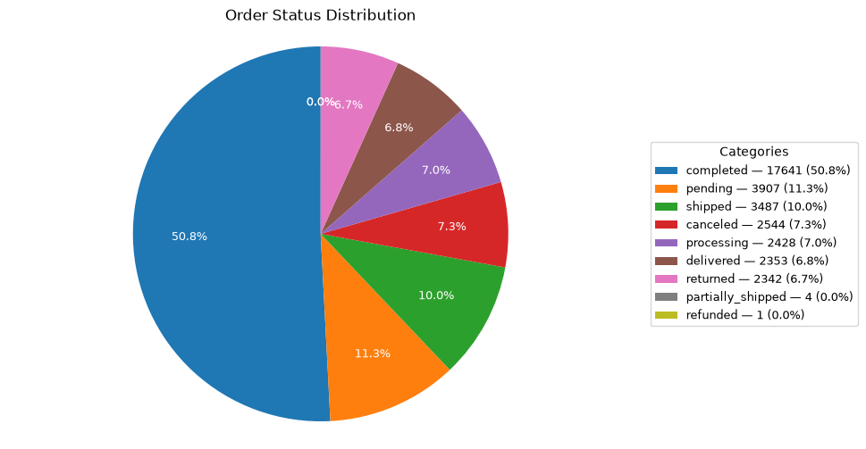

# Elasticsearch AI Agent POC

## 1. Purpose

This project is a command-line Elasticsearch AI agent proof of concept. It accepts a natural-language request, identifies the requested operation, builds an Elasticsearch query or aggregation, executes the relevant tool, and returns a human-readable result or chart artifact.

The POC demonstrates:

- Natural-language queries against Elasticsearch indexes.
- Record search, record counting, index inspection, and index listing tools.
- Deterministic pie-chart generation from Elasticsearch aggregation buckets.
- Safe handling of customer data in displayed search results.
- Structured audit logging for every request and tool call.
- Console visibility into the complete request and tool execution trail.

## 2. High-level architecture

```text
CLI / interactive chat
          ↓
Request received + request ID
          ↓
Request interpretation
          ↓
Elasticsearch tool selection
          ↓
Elasticsearch query or aggregation
          ↓
Result formatting or chart generation
          ↓
Final response + audit record
```

The chart path uses an explicit workflow:

```text
request → interpret → Elasticsearch aggregation → bucket parsing → pie-chart tool → response
```

The workflow is implemented in `elasticsearch_agent/agent/workflow.py`. Elasticsearch access is isolated in reusable tools under `elasticsearch_agent/tools/`, and audit behavior is implemented in `elasticsearch_agent/log_init.py`.

## 3. Project capabilities

### Command-line interface

The CLI supports one-shot questions, interactive chat, and an Elasticsearch health check:

```powershell
python -m elasticsearch_agent.cli "Count the records in the order index"
python -m elasticsearch_agent.cli "Create a pie chart for this month's revenue from orders"
python -m elasticsearch_agent.cli --chat
python -m elasticsearch_agent.cli --health-check
```

Interactive chat accepts one request at a time and exits with `exit`, `quit`, Ctrl-D, or Ctrl-C.

### Elasticsearch tools

The project contains reusable tools for:

- Searching an index and returning records or aggregation results.
- Counting documents in an index.
- Retrieving index data and details.
- Listing available indexes.
- Creating pie-chart PNG artifacts.

Search output is summarized to show operational fields such as order ID, order number, date, marketplace, status, and total. Customer email addresses, phone numbers, and address fields are not included in the displayed result.

### Configuration

Configuration is loaded from environment variables, including:

```dotenv
ELASTIC_SERVER=https://127.0.0.1:9200
ELASTIC_USER=elastic
ELASTIC_PASSWORD=<elasticsearch-password>
ELASTIC_VERIFY_CERTIFICATES=false
ELASTIC_INDEX=order
CHART_GROUP_FIELD=marketplaceName.keyword
APP_TIMEZONE=Asia/Kolkata
AUDIT_LOG_PATH=artifacts/audit.jsonl
CHART_OUTPUT_DIR=artifacts/charts
```

The LLM client is lazy-loaded. The deterministic chart workflow uses the configured Elasticsearch connection and does not fabricate chart values.

## 4. Demonstrated chart request

### Prompt used

```text
Query the order index and create a pie chart showing the count and percentage of orders grouped by status. Use a terms aggregation on the status field across all records. Render and return the pie chart with slice labels, percentages, legend, title, and total order count.
```

### Generated Elasticsearch aggregation

The `status` field is mapped as `text`, so the exact-value keyword subfield is used:

```json
{
  "size": 0,
  "aggs": {
    "by_status": {
      "terms": {
        "field": "status.keyword"
      }
    }
  }
}
```

### Aggregation result

The order index returned 34,707 orders:

| Status | Orders | Percentage |
|---|---:|---:|
| completed | 17,641 | 50.8% |
| pending | 3,907 | 11.3% |
| shipped | 3,487 | 10.0% |
| canceled | 2,544 | 7.3% |
| processing | 2,428 | 7.0% |
| delivered | 2,353 | 6.8% |
| returned | 2,342 | 6.7% |
| partially_shipped | 4 | 0.0% |
| refunded | 1 | 0.0% |

### Generated chart



Artifact path: `artifacts/charts/order_status_distribution_pie.png`

The chart includes a concise title, in-slice percentages, and a legend containing each status, count, and percentage. The filename is generated from the chart title.

## 5. Audit logging

Every request is assigned a unique `request_id` and written as one JSON object per line to:

```text
artifacts/audit.jsonl
```

The same structured events are also printed to stderr, which is why the request and tool trail is visible in the PowerShell console.

Each audit record includes:

- UTC timestamp.
- Request ID.
- Sequence number within the request.
- Event name.
- Tool name and arguments when applicable.
- Success or failure status.
- Tool duration in milliseconds.
- Result metadata or error details.
- Final output and chart artifact path when the request completes.

Sensitive values are redacted before being written to the audit file or console. The logger redacts credentials, API keys, passwords, authorization values, tokens, and URL credentials.

## 6. Console tool-calling trail

The successful chart request produced this sanitized execution sequence in the console:

```text
request.received
  ↓
tool.started: elastic_index_search_tool
  arguments: index_name=order
             aggregation=terms(status.keyword)
  ↓
tool.completed: elastic_index_search_tool
  status: success
  ↓
tool.started: create_pie_chart
  title: Order Status Distribution
  labels: completed, pending, shipped, canceled, processing, delivered, returned, ...
  values: 17641, 3907, 3487, 2544, 2428, 2353, 2342, ...
  ↓
tool.completed: create_pie_chart
  status: success
  ↓
request.completed
  chart_artifact: artifacts/charts/order_status_distribution_pie.png
```

The corresponding JSONL records use events such as:

```json
{"event":"request.received","sequence":1}
{"event":"tool.started","tool":"elastic_index_search_tool","sequence":2}
{"event":"tool.completed","tool":"elastic_index_search_tool","status":"success","sequence":3}
{"event":"tool.started","tool":"create_pie_chart","sequence":4}
{"event":"tool.completed","tool":"create_pie_chart","status":"success","sequence":5}
{"event":"request.completed","chart_artifact":"artifacts/charts/order_status_distribution_pie.png","sequence":6}
```

For a failed Elasticsearch request, the trail records `tool.failed` followed by `request.failed`, including the exception type and sanitized error information.

## 7. Output artifacts

```text
artifacts/
├── audit.jsonl
└── charts/
    ├── order_status_distribution_pie.png
    └── revenue_pie.png          # earlier generic chart artifact
```

The current chart renderer creates descriptive filenames such as `order_status_distribution_pie.png` instead of always using `revenue_pie.png`.

## 8. Setup and validation

Install the project and test dependencies with Python 3.11 or newer:

```powershell
python -m venv .venv
.\.venv\Scripts\Activate.ps1
pip install -e ".[test]"
pytest -q
```

Tests mock Elasticsearch and model providers, so they do not require production credentials. A live run requires a reachable Elasticsearch server, valid credentials, and a correctly mapped index.


  